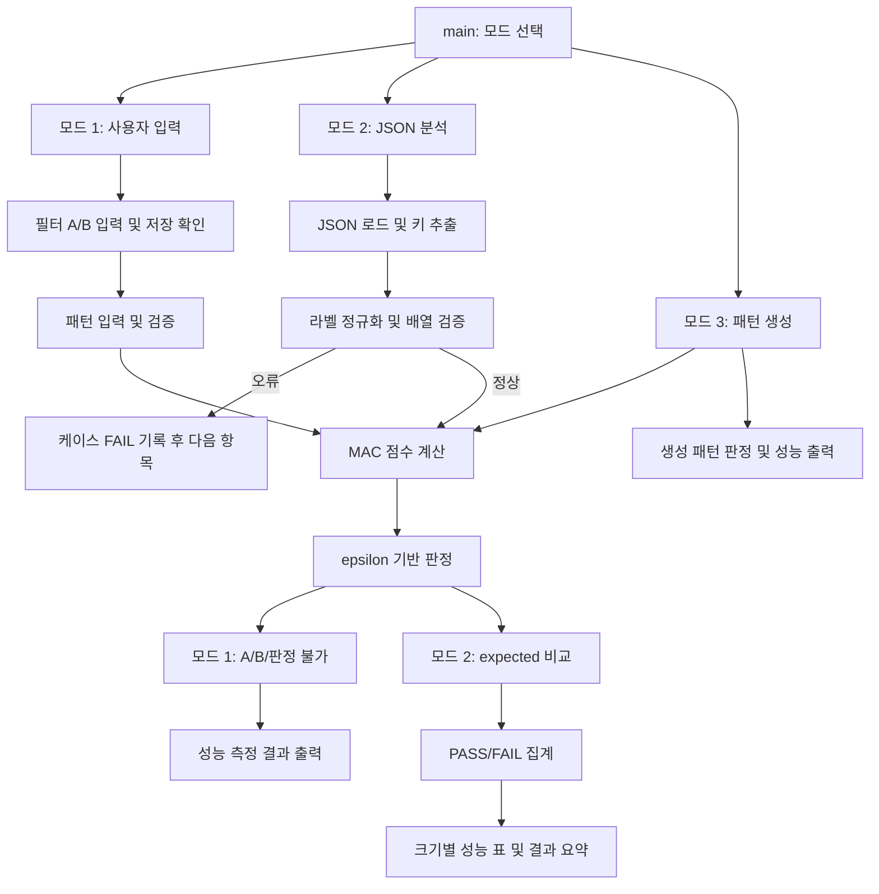
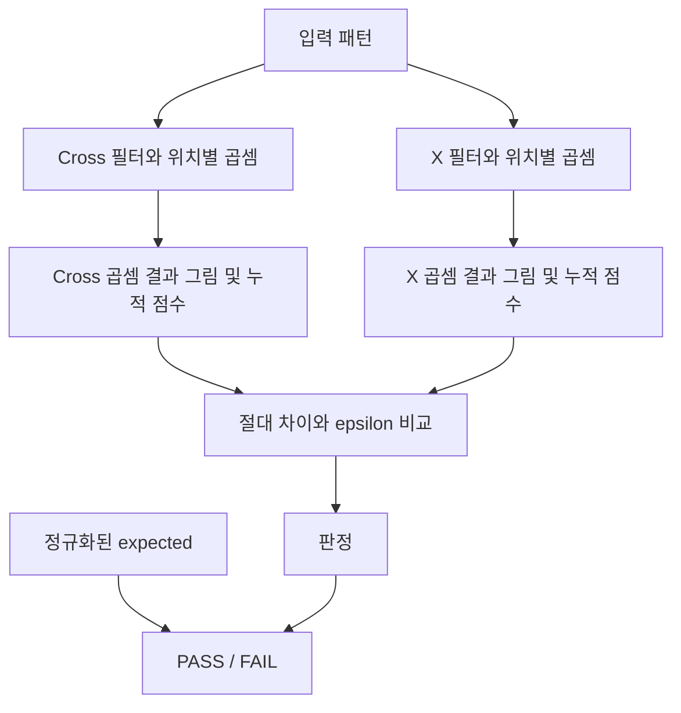

# E1-3 | Mini NPU Simulator

## 1. 과제 개요

AI의 핵심 연산인 MAC(Multiply-Accumulate)을 Python 반복문으로 구현하여 입력 패턴과 두 필터의 점수를 계산하고 Cross(+)와 X를 판별하는 콘솔 애플리케이션이다. 실제 NPU 하드웨어를 구동하거나 신경망을 학습시키는 프로그램이 아니라, 사전에 정의된 가중치로 MAC 연산과 수치 비교, 데이터 검증, 연산량 증가를 실험하는 시뮬레이터이다.

| 구분 | 구현 내용 |
|---|---|
| 모드 1 | 3×3 필터 A/B와 패턴 입력, 저장 확인, 점수·시간·판정 출력 |
| 모드 2 | JSON의 5×5, 13×13, 25×25 데이터 로드 및 일괄 판정 |
| 성능 분석 | 3·5·13·25 크기별 MAC 평균 시간 및 N² 출력 |
| 결과 리포트 | 전체 테스트 집계, 실패 케이스와 원인 분석 |
| 보너스 | 1차원 MAC 비교 및 패턴 자동 생성 |
| 학습 보조 | Mini NPU Visual Lab V9에서 데이터·코드·계산 시각화 |

## 2. 개발 환경 및 실행 방법

- 과제 환경: Python 3.8 이상
- 검증 환경: Python 3.13.5
- 외부 라이브러리 없이 `json`, `math`, `re`, `time`, `pathlib` 사용

```text
e1-3/
├── main.py                       # Python 콘솔 애플리케이션
├── data.json                     # 필터 및 테스트 패턴
├── README.md                     # 구현 및 결과 보고서
└── Mini_NPU_Visual_Lab_V9.html    # 선택적 학습 보조 파일
```


```powershell
python --version
python main.py
```

```text
1. 사용자 입력 (3×3)
2. data.json 분석
3. 패턴 자동 생성 (보너스)
선택:
```

모드 1은 직접 입력, 모드 2는 JSON 일괄 분석을 수행하며, 모드 3은 홀수 크기의 패턴을 생성하고 판정 및 측정에 활용한다. HTML 학습 도구는 별도 설치 없이 브라우저에서 열 수 있다.

## 3. 핵심 개념 및 MAC 원리

| 용어 | 의미 |
|---|---|
| Pattern | 판별 대상인 입력 배열 |
| Filter / Kernel | 비교 기준이 되는 가중치 배열 |
| Weight | 각 위치가 점수에 기여하는 정도 |
| MAC | 같은 위치의 두 숫자를 곱하고 누적하는 연산 |
| NPU | 신경망의 대량 행렬·텐서 연산에 특화된 처리 장치 |
| Epsilon | 두 점수의 미세한 차이를 동점으로 인정하는 허용오차 |
| Expected | 데이터에 기록된 기대 정답 |
| PASS / FAIL | 프로그램 판정과 기대 정답의 일치 여부 |

### 3.1 그림을 배열로 표현하기

```text
Cross (+)       X
0 1 0           1 0 1
1 1 1           0 1 0
0 1 0           1 0 1
```

이 과제의 이진 입력에서 1은 채워진 위치, 0은 비어 있는 위치이다. 필터의 0.1, 0.9, 1.0 등은 출제 데이터에 미리 설정된 가중치이며 입력값에서 계산해 얻는 숫자가 아니다. MAC 점수는 필터의 반응값이며 확률이나 정규화된 유사도는 아니다.

### 3.2 MAC 계산식

$$S=\sum_{i=0}^{N-1}\sum_{j=0}^{N-1}P_{ij}K_{ij}$$

Cross 입력을 두 필터에 각각 적용한다.

```text
Cross 입력       Cross 필터      곱셈 결과
0 1 0            0 1 0           0 1 0
1 1 1     ×      1 1 1     =     1 1 1
0 1 0            0 1 0           0 1 0
누적 점수: 0+1+0+1+1+1+0+1+0 = 5

Cross 입력       X 필터          곱셈 결과
0 1 0            1 0 1           0 0 0
1 1 1     ×      0 1 0     =     0 1 0
0 1 0            1 0 1           0 0 0
누적 점수: 0+0+0+0+1+0+0+0+0 = 1
```

Cross 점수 5가 X 점수 1보다 높으므로 Cross로 판정한다. 신경망의 선형 변환과 합성곱에도 이러한 곱셈·누적이 반복되므로 NPU는 대량 MAC 처리와 데이터 재사용에 특화된다.

## 4. 시스템 설계



### 4.1 Python 함수 구성 (16개)

| 함수 | 입력 및 처리 | 결과 |
|---|---|---|
| `main()` | 메뉴 선택 | 모드 함수 호출 |
| `run_manual_mode()` | 필터·패턴 입력 및 MAC 반복 호출 | 점수, 판정, 시간 출력 |
| `read_row(prompt)` | 공백으로 구분된 숫자 3개 검증 | 실수 리스트 |
| `read_matrix(matrix_name)` | `read_row()` 3회 호출 | 3×3 리스트 |
| `mac_score(pattern, filter_matrix)` | 이중 반복문으로 위치별 곱셈·누적 | MAC 점수 |
| `decide_filter(score_a, score_b)` | 허용오차 및 점수 비교 | A/B/판정 불가 |
| `run_json_mode()` | 파일 로드, 케이스별 검증·분류 | PASS/FAIL 및 요약 출력 |
| `normalize_label(label)` | 공백 제거, 소문자 변환, 매핑 | Cross/X 또는 예외 |
| `check_matrix(matrix, size, name)` | 행·열·숫자 유효성 검사 | 정상 종료 또는 예외 |
| `decide_shape(cross_score, x_score)` | 허용오차 및 점수 비교 | Cross/X/판정 불가 |
| `print_json_timing(samples)` | 크기별 측정 및 2D/1D 비교 | 평균 시간 표 |
| `generate_pattern(size, shape)` | 중앙 행·열 또는 대각선 조건으로 배열 생성 | N×N 리스트 |
| `flatten_matrix(matrix)` | 행 우선 순서로 펼치기 | 길이 N² 리스트 |
| `mac_flat(pattern, filter_values)` | 길이 검사 후 위치별 곱셈·누적 | MAC 점수 |
| `measure_mac(function, sample, first, second)` | 워밍업 후 각 필터 10회 측정 | 평균 ms |
| `run_generator_mode()` | 홀수 N 입력 및 생성 패턴 재사용 | 패턴·판정·시간 출력 |

## 5. 핵심 구현 코드

아래 코드는 최종 `main.py`에서 발췌한 실제 구현이다. 일부 연결 코드는 핵심 구간만 제시한다.

### 5.1 2차원 데이터와 MAC 함수

```python
def mac_score(pattern, filter_matrix):
    total = 0

    for row in range(len(pattern)):
        for column in range(len(pattern[row])):
            total = total + pattern[row][column] * filter_matrix[row][column]

    return total
```

`row`는 행 인덱스, `column`은 열 인덱스이다. 두 배열에서 동일한 인덱스의 값을 읽고 곱한 뒤 `total`에 더한다. 인덱스는 0부터 시작한다. `return total`은 계산된 점수를 호출한 곳에 전달한다. 예를 들어 `matrix[1][2]`는 두 번째 행의 세 번째 값이며, `matrix[1][2] = 1`로 값을 저장할 수 있다.

### 5.2 모드 1 입력 검증과 저장

```python
def read_row(prompt):
    while True:
        text = input(prompt)
        parts = text.split()

        if len(parts) != 3:
            print("입력 오류: 숫자 3개를 공백으로 구분해 입력하세요.")
            continue

        row = []

        try:
            for part in parts:
                row.append(float(part))
        except ValueError:
            print("입력 오류: 숫자로 입력하세요.")
            continue

        if not all(math.isfinite(value) for value in row):
            print("입력 오류: NaN 및 무한대는 사용할 수 없습니다.")
            continue

        return row


def read_matrix(matrix_name):
    matrix = []

    for row_number in range(1, 4):
        prompt = f"{matrix_name} {row_number}행: "
        row = read_row(prompt)
        matrix.append(row)

    return matrix
```

각 행은 3개의 숫자로 구성되며, 잘못된 행은 재입력한다. 정상 행 3개를 모아 배열을 완성한다. 필터 A/B 저장 확인에서 `y`를 선택하면 패턴 입력으로 진행하고, `n`이면 필터를 다시 입력한다. 여기서 저장은 실행 중 메모리에 보관한다는 의미이다. 행 수는 정상 행 3개를 순차적으로 받아 보장한다. 행 전체를 한꺼번에 받아 행 수를 검증하는 방식은 아니다. NaN·무한대를 거부하며, 계산 결과가 유한하지 않으면 패턴을 다시 입력한다.

### 5.3 JSON 구조 및 키 규칙

```text
data.json
├── meta                         # 파일 설명, MAC에 사용하지 않음
├── filters
│   ├── size_5  → cross, x
│   ├── size_13 → cross, x
│   └── size_25 → cross, x
└── patterns
    ├── size_5_1  → input, expected
    ├── size_5_2  → input, expected
    ├── size_13_1 → input, expected
    ├── size_13_2 → input, expected
    ├── size_25_1 → input, expected
    └── size_25_2 → input, expected
```

`size_5_1`은 5×5 크기의 첫 번째 테스트 케이스이다. `size_{N}_{idx}`에서 N을 추출하고 `filters.size_N`에 해당하는 두 필터를 선택한다.

```python
match = re.fullmatch(r"size_([1-9][0-9]*)_[0-9]+", case_name)
if match is None or not isinstance(case, dict):
    raise ValueError("케이스 이름 또는 형식이 잘못되었습니다.")

size = int(match.group(1))
expected = normalize_label(case.get("expected"))
input_matrix = case.get("input")
check_matrix(input_matrix, size, "입력 배열")

group = filter_groups.get(f"size_{size}")
```

### 5.4 라벨 정규화

| 구분 | 원본 | 표준 라벨 |
|---|---|---|
| expected | `+` | Cross |
| expected | `x` | X |
| filter 키 | `cross` | Cross |
| filter 키 | `x` | X |

```python
def normalize_label(label):
    labels = {"+": "Cross", "cross": "Cross", "x": "X"}
    if not isinstance(label, str) or label.strip().lower() not in labels:
        raise ValueError(f"알 수 없는 라벨: {label!r}")
    return labels[label.strip().lower()]
```

동일한 의미를 가진 문자열을 표준화하여 문자열 표기 차이로 인한 잘못된 FAIL을 방지한다.

### 5.5 스키마 및 배열 크기 검증

```python
def check_matrix(matrix, size, name):
    if not isinstance(matrix, list) or len(matrix) != size:
        raise ValueError(f"{name}의 행이 {size}개여야 합니다.")

    for row_number, row in enumerate(matrix, start=1):
        if not isinstance(row, list) or len(row) != size:
            raise ValueError(f"{name} {row_number}행의 값이 {size}개여야 합니다.")
        for value in row:
            if type(value) not in (int, float) or not math.isfinite(value):
                raise ValueError(f"{name} {row_number}행에 유효하지 않은 숫자가 있습니다.")
```

모드 2는 최상위 객체, filters/patterns 객체, 케이스 키, 필터 묶음, 중복 표준 라벨, 입력 및 필터 크기, 유한한 숫자와 MAC 점수를 검증한다. 개별 케이스 오류는 예외 처리 후 다음 항목을 계속 분석한다.

### 5.6 허용오차 및 판정

```python
EPSILON = 1e-9

def decide_shape(cross_score, x_score):
    if abs(cross_score - x_score) < EPSILON:
        return "판정 불가"
    elif cross_score > x_score:
        return "Cross"
    else:
        return "X"


def decide_filter(score_a, score_b):
    if abs(score_a - score_b) < EPSILON:
        return "판정 불가"
    elif score_a > score_b:
        return "A"
    else:
        return "B"
```

허용오차는 `1e-9 = 0.000000001`이다. 절대 차이가 이 값보다 작으면 동점이다. 정확히 기준과 같은 차이는 엄격한 `<` 조건에 포함되지 않는다. 모드 2에서는 판정 불가를 `UNDECIDED`로 표시한다.

```python
result = decide_shape(cross_score, x_score)
if result == "판정 불가":
    result = "UNDECIDED"

status = "PASS" if result == expected else "FAIL"
```

판정은 두 점수를 비교하는 과정이고, 채점은 그 판정을 기대값과 비교하는 과정이다.

## 6. 실행 및 검증 결과

### 6.1 모드 1: 3×3 직접 입력

필터 A를 Cross, 필터 B를 X로 지정하고 저장 확인에 `y`를 입력한다.

| 입력 패턴 | A 점수 | B 점수 | 판정 | MAC 1회 평균(ms) |
|---|---:|---:|---|---:|
| Cross | 5.0 | 1.0 | A | 0.000866 |
| X | 1.0 | 5.0 | B | 0.000634 |
| 중심 칸만 1 | 1.0 | 1.0 | 판정 불가 | 0.000619 |

X 입력의 실제 출력:

```text
필터 A 점수: 1.0
필터 B 점수: 5.0
판정: B
MAC 1회 평균 시간 (A·B 각 10회): 0.000634 ms
크기 | MAC 1회 평균(ms) | 위치 수(N²)
3×3 | 0.000634 | 9
```

### 6.2 모드 2: 원본 JSON 분석

| 케이스 | Cross 점수 | X 점수 | 판정 | expected | 결과 |
|---|---:|---:|---|---|---|
| size_5_1 | 0.9 | 0.8999999999999999 | UNDECIDED | X | FAIL |
| size_5_2 | 8.9 | 0.1 | Cross | Cross | PASS |
| size_13_1 | 0.3 | 14.700000000000008 | X | X | PASS |
| size_13_2 | 7.499999999999997 | 7.5 | UNDECIDED | Cross | FAIL |
| size_25_1 | 4.9 | 4.899999999999999 | UNDECIDED | X | FAIL |
| size_25_2 | 52.9 | 0.1 | Cross | Cross | PASS |

```text
전체 6건 | PASS 3건 | FAIL 3건
- size_5_1: 허용 오차 안에서 동점
- size_13_2: 허용 오차 안에서 동점
- size_25_1: 허용 오차 안에서 동점
```

위 결과는 과제 문서의 참고 출력이 아닌 첨부 코드와 원본 JSON을 Python 3.13.5에서 재실행한 값이다.

### 6.3 입력 및 스키마 검증 결과

| 검증 입력 | 실제 결과 |
|---|---|
| 한 행에 `0 1` 입력 | 숫자 3개 입력 안내 후 해당 행 재입력 |
| 한 행에 `a b c` 입력 | 숫자 입력 안내 후 해당 행 재입력 |
| 복사한 JSON의 size_5_1 입력 배열에서 한 행 제거 | `입력 배열의 행이 5개여야 합니다.`와 FAIL 출력, 이후 5개 케이스 계속 처리 |

추가로 `nan 0 1`은 NaN 및 무한대 사용 불가 안내 후 재입력되었다. 복사본에서 size_5_2의 expected를 `o`로 변경하면 알 수 없는 라벨 오류로 FAIL 처리되었으며, 이후 케이스는 계속 처리되었다. 두 오류를 동시에 주입한 실행은 총 6건, PASS 2건, FAIL 4건이었다. 원본 JSON은 변경하지 않았다. 이러한 검증은 분류 정확도와 별개로 입력 처리와 예외 처리 기능을 확인한다.

### 6.4 그림과 계산 근거를 연결한 케이스별 분석

입력 패턴, 필터, 곱셈 결과를 같은 위치에서 비교한다. 아래 그림은 원본 JSON 배열에서 직접 생성한 축약 도식이다. `■`는 0이 아닌 값, `·`는 0을 뜻한다. 필터의 `■`는 동일한 가중치라는 뜻이 아니며, 실제 가중치와 개수는 계산표에서 확인한다. 곱셈 결과의 `■`만 점수에 기여한다. V9의 06번 메뉴에서는 모든 칸의 실제 숫자도 표시할 수 있다.

| 케이스 | 기대값 | Cross 계산 (수학적) | X 계산 (수학적) | 판정 | 결과 |
|---|---|---|---|---|---|
| `size_5_1` | X | 1 × 0.9 = 0.90 | 9 × 0.1 = 0.90 | UNDECIDED | FAIL |
| `size_5_2` | Cross | 1 × 0.9 + 8 × 1 = 8.90 | 1 × 0.1 = 0.10 | Cross | PASS |
| `size_13_1` | X | 1 × 0.3 = 0.30 | 24 × 0.3 + 1 × 7.5 = 14.70 | X | PASS |
| `size_13_2` | Cross | 25 × 0.3 = 7.50 | 1 × 7.5 = 7.50 | UNDECIDED | FAIL |
| `size_25_1` | X | 1 × 4.9 = 4.90 | 49 × 0.1 = 4.90 | UNDECIDED | FAIL |
| `size_25_2` | Cross | 48 × 1 + 1 × 4.9 = 52.90 | 1 × 0.1 = 0.10 | Cross | PASS |

#### size_5_1 — 5×5, expected = X

```text
입력 패턴
■···■
·■·■·
··■··
·■·■·
■···■
```

| 비교 | 점수 기여 위치 | 수학적 계산 | 실제 Python 누적값 |
|---|---:|---|---:|
| Cross | 1 | 1 × 0.9 = 0.90 | 0.9 |
| X | 9 | 9 × 0.1 = 0.90 | 0.8999999999999999 |

```text
Cross 필터  Cross 곱셈 결과
··■··   ·····
··■··   ·····
■■■■■   ··■··
··■··   ·····
··■··   ·····

X 필터      X 곱셈 결과
■···■   ■···■
·■·■·   ·■·■·
··■··   ··■··
·■·■·   ·■·■·
■···■   ■···■
```

절대 점수 차이: `1.110223e-16`. 판정 **UNDECIDED**, expected **X**, 결과 **FAIL**. 수학적 동점이므로 허용오차 정책에 따라 판정 불가로 처리한다.

#### size_5_2 — 5×5, expected = Cross

```text
입력 패턴
··■··
··■··
■■■■■
··■··
··■··
```

| 비교 | 점수 기여 위치 | 수학적 계산 | 실제 Python 누적값 |
|---|---:|---|---:|
| Cross | 9 | 1 × 0.9 + 8 × 1 = 8.90 | 8.9 |
| X | 1 | 1 × 0.1 = 0.10 | 0.1 |

```text
Cross 필터  Cross 곱셈 결과
··■··   ··■··
··■··   ··■··
■■■■■   ■■■■■
··■··   ··■··
··■··   ··■··

X 필터      X 곱셈 결과
■···■   ·····
·■·■·   ·····
··■··   ··■··
·■·■·   ·····
■···■   ·····
```

절대 점수 차이: `8.800000e+00`. 판정 **Cross**, expected **Cross**, 결과 **PASS**. 높은 점수의 필터가 기대값과 일치한다.

#### size_13_1 — 13×13, expected = X

```text
입력 패턴
■···········■
·■·········■·
··■·······■··
···■·····■···
····■···■····
·····■·■·····
······■······
·····■·■·····
····■···■····
···■·····■···
··■·······■··
·■·········■·
■···········■
```

| 비교 | 점수 기여 위치 | 수학적 계산 | 실제 Python 누적값 |
|---|---:|---|---:|
| Cross | 1 | 1 × 0.3 = 0.30 | 0.3 |
| X | 25 | 24 × 0.3 + 1 × 7.5 = 14.70 | 14.700000000000008 |

```text
Cross 필터          Cross 곱셈 결과
······■······   ·············
······■······   ·············
······■······   ·············
······■······   ·············
······■······   ·············
······■······   ·············
■■■■■■■■■■■■■   ······■······
······■······   ·············
······■······   ·············
······■······   ·············
······■······   ·············
······■······   ·············
······■······   ·············

X 필터              X 곱셈 결과
■···········■   ■···········■
·■·········■·   ·■·········■·
··■·······■··   ··■·······■··
···■·····■···   ···■·····■···
····■···■····   ····■···■····
·····■·■·····   ·····■·■·····
······■······   ······■······
·····■·■·····   ·····■·■·····
····■···■····   ····■···■····
···■·····■···   ···■·····■···
··■·······■··   ··■·······■··
·■·········■·   ·■·········■·
■···········■   ■···········■
```

절대 점수 차이: `1.440000e+01`. 판정 **X**, expected **X**, 결과 **PASS**. 높은 점수의 필터가 기대값과 일치한다.

#### size_13_2 — 13×13, expected = Cross

```text
입력 패턴
······■······
······■······
······■······
······■······
······■······
······■······
■■■■■■■■■■■■■
······■······
······■······
······■······
······■······
······■······
······■······
```

| 비교 | 점수 기여 위치 | 수학적 계산 | 실제 Python 누적값 |
|---|---:|---|---:|
| Cross | 25 | 25 × 0.3 = 7.50 | 7.499999999999997 |
| X | 1 | 1 × 7.5 = 7.50 | 7.5 |

```text
Cross 필터          Cross 곱셈 결과
······■······   ······■······
······■······   ······■······
······■······   ······■······
······■······   ······■······
······■······   ······■······
······■······   ······■······
■■■■■■■■■■■■■   ■■■■■■■■■■■■■
······■······   ······■······
······■······   ······■······
······■······   ······■······
······■······   ······■······
······■······   ······■······
······■······   ······■······

X 필터              X 곱셈 결과
■···········■   ·············
·■·········■·   ·············
··■·······■··   ·············
···■·····■···   ·············
····■···■····   ·············
·····■·■·····   ·············
······■······   ······■······
·····■·■·····   ·············
····■···■····   ·············
···■·····■···   ·············
··■·······■··   ·············
·■·········■·   ·············
■···········■   ·············
```

절대 점수 차이: `2.664535e-15`. 판정 **UNDECIDED**, expected **Cross**, 결과 **FAIL**. 수학적 동점이므로 허용오차 정책에 따라 판정 불가로 처리한다.

#### size_25_1 — 25×25, expected = X

```text
입력 패턴
■·······················■
·■·····················■·
··■···················■··
···■·················■···
····■···············■····
·····■·············■·····
······■···········■······
·······■·········■·······
········■·······■········
·········■·····■·········
··········■···■··········
···········■·■···········
············■············
···········■·■···········
··········■···■··········
·········■·····■·········
········■·······■········
·······■·········■·······
······■···········■······
·····■·············■·····
····■···············■····
···■·················■···
··■···················■··
·■·····················■·
■·······················■
```

| 비교 | 점수 기여 위치 | 수학적 계산 | 실제 Python 누적값 |
|---|---:|---|---:|
| Cross | 1 | 1 × 4.9 = 4.90 | 4.9 |
| X | 49 | 49 × 0.1 = 4.90 | 4.899999999999999 |

```text
Cross 필터                      Cross 곱셈 결과
············■············   ·························
············■············   ·························
············■············   ·························
············■············   ·························
············■············   ·························
············■············   ·························
············■············   ·························
············■············   ·························
············■············   ·························
············■············   ·························
············■············   ·························
············■············   ·························
■■■■■■■■■■■■■■■■■■■■■■■■■   ············■············
············■············   ·························
············■············   ·························
············■············   ·························
············■············   ·························
············■············   ·························
············■············   ·························
············■············   ·························
············■············   ·························
············■············   ·························
············■············   ·························
············■············   ·························
············■············   ·························

X 필터                          X 곱셈 결과
■·······················■   ■·······················■
·■·····················■·   ·■·····················■·
··■···················■··   ··■···················■··
···■·················■···   ···■·················■···
····■···············■····   ····■···············■····
·····■·············■·····   ·····■·············■·····
······■···········■······   ······■···········■······
·······■·········■·······   ·······■·········■·······
········■·······■········   ········■·······■········
·········■·····■·········   ·········■·····■·········
··········■···■··········   ··········■···■··········
···········■·■···········   ···········■·■···········
············■············   ············■············
···········■·■···········   ···········■·■···········
··········■···■··········   ··········■···■··········
·········■·····■·········   ·········■·····■·········
········■·······■········   ········■·······■········
·······■·········■·······   ·······■·········■·······
······■···········■······   ······■···········■······
·····■·············■·····   ·····■·············■·····
····■···············■····   ····■···············■····
···■·················■···   ···■·················■···
··■···················■··   ··■···················■··
·■·····················■·   ·■·····················■·
■·······················■   ■·······················■
```

절대 점수 차이: `1.776357e-15`. 판정 **UNDECIDED**, expected **X**, 결과 **FAIL**. 수학적 동점이므로 허용오차 정책에 따라 판정 불가로 처리한다.

#### size_25_2 — 25×25, expected = Cross

```text
입력 패턴
············■············
············■············
············■············
············■············
············■············
············■············
············■············
············■············
············■············
············■············
············■············
············■············
■■■■■■■■■■■■■■■■■■■■■■■■■
············■············
············■············
············■············
············■············
············■············
············■············
············■············
············■············
············■············
············■············
············■············
············■············
```

| 비교 | 점수 기여 위치 | 수학적 계산 | 실제 Python 누적값 |
|---|---:|---|---:|
| Cross | 49 | 48 × 1 + 1 × 4.9 = 52.90 | 52.9 |
| X | 1 | 1 × 0.1 = 0.10 | 0.1 |

```text
Cross 필터                      Cross 곱셈 결과
············■············   ············■············
············■············   ············■············
············■············   ············■············
············■············   ············■············
············■············   ············■············
············■············   ············■············
············■············   ············■············
············■············   ············■············
············■············   ············■············
············■············   ············■············
············■············   ············■············
············■············   ············■············
■■■■■■■■■■■■■■■■■■■■■■■■■   ■■■■■■■■■■■■■■■■■■■■■■■■■
············■············   ············■············
············■············   ············■············
············■············   ············■············
············■············   ············■············
············■············   ············■············
············■············   ············■············
············■············   ············■············
············■············   ············■············
············■············   ············■············
············■············   ············■············
············■············   ············■············
············■············   ············■············

X 필터                          X 곱셈 결과
■·······················■   ·························
·■·····················■·   ·························
··■···················■··   ·························
···■·················■···   ·························
····■···············■····   ·························
·····■·············■·····   ·························
······■···········■······   ·························
·······■·········■·······   ·························
········■·······■········   ·························
·········■·····■·········   ·························
··········■···■··········   ·························
···········■·■···········   ·························
············■············   ············■············
···········■·■···········   ·························
··········■···■··········   ·························
·········■·····■·········   ·························
········■·······■········   ·························
·······■·········■·······   ·························
······■···········■······   ·························
·····■·············■·····   ·························
····■···············■····   ·························
···■·················■···   ·························
··■···················■··   ·························
·■·····················■·   ·························
■·······················■   ·························
```

절대 점수 차이: `5.280000e+01`. 판정 **Cross**, expected **Cross**, 결과 **PASS**. 높은 점수의 필터가 기대값과 일치한다.

**해석:** 겹치는 칸의 수가 많아도 가중치가 작으면 점수가 낮거나 동점이 될 수 있다. 이 과제의 MAC 점수는 가중합이며 정규화된 유사도나 확률은 아니다. `expected`는 계산에 참여하지 않고 판정 이후 채점에만 사용한다.

## 7. 성능 분석

### 7.1 측정 방법

```python
REPETITIONS = 10

def measure_mac(function, sample, first, second):
    """필터별 10회, 총 20회 호출의 1회 평균(ms). I/O 제외."""
    function(sample, first)  # 워밍업 (측정 제외)
    function(sample, second)
    start = time.perf_counter()
    for _ in range(REPETITIONS):
        function(sample, first)
        function(sample, second)
    return (time.perf_counter() - start) * 1000 / (2 * REPETITIONS)
```

- 각 필터를 한 번씩 워밍업한 뒤, Cross 및 X 필터를 각각 10회 호출한다(측정 총 20회).
- `perf_counter()`로 연산 함수 호출 구간을 측정한다.
- 초 단위 시간을 1,000배하여 ms로 변환하고 20으로 나누어 MAC 함수 1회 평균을 구한다.
- 파일 읽기, 데이터 검증, 콘솔 입력·출력은 측정 구간에 포함하지 않는다.
- 3×3은 코드 내부의 기본 패턴, 나머지는 각 크기의 첫 번째 유효한 JSON 샘플을 사용한다.

### 7.2 측정 결과 (Python 3.13.5)

| 크기 | MAC 1회 평균(ms) | 필터 1개 위치 수(N²) | 필터 2개 위치 수(2N²) |
|---|---:|---:|---:|
| 3×3 | 0.000611 | 9 | 18 |
| 5×5 | 0.001250 | 25 | 50 |
| 13×13 | 0.009616 | 169 | 338 |
| 25×25 | 0.022931 | 625 | 1,250 |

측정값은 실행 환경과 시스템 부하에 따라 달라지며, 브라우저의 JavaScript 측정값과 구분한다.

### 7.3 시간 복잡도

외부 반복문 N회와 내부 반복문 N회로 N²개의 위치를 계산한다. 필터가 두 개이면 2N²회이지만 상수 2를 제외하므로 시간 복잡도는 O(N²)이다. 한 변이 두 배가 되면 계산 위치는 네 배가 된다. MAC 함수 자체의 추가 공간 복잡도는 누적 변수 및 인덱스만 필요하므로 O(1)이며, 입력 배열 저장 공간은 O(N²)이다.

## 8. 결과 리포트 — 실패 원인 및 시간 복잡도 분석

### 8.1 동점이 발생한 데이터의 구조

| 실패 케이스 | Cross의 수학적 계산 | X의 수학적 계산 | 동점 점수 |
|---|---|---|---:|
| size_5_1 | 1 × 0.9 | 9 × 0.1 | 0.9 |
| size_13_2 | 25 × 0.3 | 1 × 7.5 | 7.5 |
| size_25_1 | 1 × 4.9 | 49 × 0.1 | 4.9 |

예를 들어 size_5_1은 X 모양 입력이지만 Cross 필터 중심의 가중치 0.9와 X 필터의 아홉 개 가중치 0.1이 동일한 수학적 점수를 만든다.

```text
Cross 곱셈 결과      X 곱셈 결과
0   0   0   0   0    0.1 0   0   0   0.1
0   0   0   0   0    0   0.1 0   0.1 0
0   0   0.9 0   0    0   0   0.1 0   0
0   0   0   0   0    0   0.1 0   0.1 0
0   0   0   0   0    0.1 0   0   0   0.1
```

### 8.2 부동소수점 오차

0.1은 이진 부동소수점으로 정확히 저장할 수 없으며, 순차 덧셈에서 반올림 오차가 발생한다.

| 누적 횟수 | 수학적 값 | Python 순차 누적값 |
|---:|---:|---:|
| 1 | 0.1 | 0.1 |
| 2 | 0.2 | 0.2 |
| 3 | 0.3 | 0.30000000000000004 |
| 4 | 0.4 | 0.4 |
| 5 | 0.5 | 0.5 |
| 6 | 0.6 | 0.6 |
| 7 | 0.7 | 0.7 |
| 8 | 0.8 | 0.7999999999999999 |
| 9 | 0.9 | 0.8999999999999999 |

size_5_1의 점수 차이는 약 1.11×10⁻¹⁶으로 허용오차 10⁻⁹보다 작다. 따라서 수학적으로 동점인 두 점수를 `UNDECIDED`로 처리한다. 부동소수점 오차가 동점을 만든 것이 아니라, 원래 동점인 점수가 미세하게 다르게 표현된 것이다.

### 8.3 결과 분석 (과제 요구사항: 최소 10줄 이상)

1. 원본 JSON의 총 6개 케이스 중 3개가 PASS, 3개가 FAIL로 나타났다.
2. PASS/FAIL은 분류 결과와 expected의 일치 여부를 의미하며 프로그램 실행 성공 여부와는 구분된다.
3. 세 실패 케이스는 정상적으로 데이터를 로드하고 MAC 연산을 수행하였다.
4. 실패 원인은 배열 크기 불일치나 라벨 오류가 아니라 두 필터의 가중치 구조에 따른 동점이다.
5. size_5_1의 수학적 점수는 두 필터 모두 0.9이다.
6. size_13_2의 수학적 점수는 두 필터 모두 7.5이다.
7. size_25_1의 수학적 점수는 두 필터 모두 4.9이다.
8. 이진 부동소수점의 제한 때문에 반복 덧셈 결과에는 미세한 차이가 나타난다.
9. 허용오차 1e-9 미만의 차이를 동점으로 인정하는 비교 정책을 적용하였다.
10. UNDECIDED는 Cross 또는 X인 expected와 일치하지 않으므로 FAIL로 집계된다.
11. 라벨 정규화는 `+`, `cross`, `x`와 같은 서로 다른 표기를 일관된 표준 라벨로 비교하게 한다.
12. 스키마 오류는 연산 전에 검증하며, 오류가 난 케이스만 FAIL 처리하고 후속 분석을 계속한다.
13. MAC은 N×N 배열의 모든 위치를 한 번씩 방문하므로 한 필터에서 N²회 수행한다.
14. 3×3에서 25×25로 크기가 증가하면 위치 수는 9에서 625로 증가한다.
15. 두 필터를 사용하는 경우 2N²회 연산하지만 시간 복잡도는 O(N²)로 동일하다.
16. 실제 반복 측정 결과도 크기가 커질수록 평균 연산 시간이 증가하는 경향을 보였다.
17. 측정 시간은 실행 환경의 영향을 받으므로 N²와 정확히 동일한 비율로 증가할 필요는 없다.
18. 현재 규칙을 유지한 채 분류 정확도를 개선하려면 필터 가중치의 설계를 검토해야 하며, 단순히 동점을 강제로 정답 처리해서는 안 된다.

### 8.4 실패 진단 기준

| 유형 | 확인 대상 | 개선 방향 |
|---|---|---|
| 데이터/스키마 | 키, 필터 누락, 행·열 수, 자료형 | 데이터 구조 검증 및 케이스 단위 예외 처리 |
| 로직 | 잘못된 필터 선택, 인덱스, 누적, 라벨 비교 | 함수별 입력·출력 및 계산 추적 |
| 수치 비교 | 미세한 소수 차이, 동점 기준 | 절대 차이와 epsilon 확인 |
| 정상 정책에 따른 FAIL | 동일한 수학적 점수, expected 불일치 | 가중치 설계 검토 및 판정 근거 기록 |

## 9. 기능 요구사항 충족 현황

| 필수 항목 | 구현 근거 |
|---|---|
| N×N 배열 및 위치 접근 | 2차원 리스트, `mac_score()` |
| 3×3 직접 입력과 저장 확인 | `read_row()`, `read_matrix()`, `run_manual_mode()` |
| 행별 입력 검증 | 숫자 개수 검사, `float()` 변환 예외 처리 |
| JSON 로드·키 분석·크기 검사 | `run_json_mode()`, `check_matrix()` |
| 라벨 정규화 | `normalize_label()` |
| 외부 라이브러리 없는 MAC | Python 이중 반복문 |
| epsilon 비교 | `decide_shape()`, `decide_filter()` |
| 판정 및 PASS/FAIL | 모드별 결과 출력, expected 비교 |
| 크기별 10회 반복 측정 | `measure_mac()`, `print_json_timing()` |
| 결과 집계 및 실패 사유 | `failures` 리스트, 전체 결과 출력 |
| README 결과 리포트 | 7~8절의 실측값과 분석 |

모드 1은 정상 행 3개를 순서대로 입력받아 행 수를 보장하며 열 개수·숫자 파싱·비유한 실수를 검사한다. EOF 또는 Ctrl+C는 최상위에서 종료 메시지를 출력한다. 저장 확인은 파일 영구 저장이 아니다.

## 10. 보너스 과제 구현 및 검증

### 10.1 1차원 배열 최적화

```python
def flatten_matrix(matrix):
    """2차원 배열을 행 우선 순서의 1차원 배열로 변환한다."""
    return [value for row in matrix for value in row]

def mac_flat(pattern, filter_values):
    """1차원 배열의 MAC. 원래 위치 순서를 유지한다."""
    if len(pattern) != len(filter_values):
        raise ValueError("1차원 배열의 길이가 일치해야 합니다.")
    total = 0
    for value, weight in zip(pattern, filter_values):
        total += value * weight
    return total
```

행 우선 순서로 데이터를 펼치면 `matrix[r][c]`는 `flat[r*N+c]`에 대응한다. 중첩 인덱싱 대신 `zip()`을 이용하지만 전체 위치 수와 시간 복잡도는 동일하다.

| 크기 | 2D 평균(ms) | 1D 평균(ms) | 변환 1회(ms) | 점수 일치 |
|---|---:|---:|---:|---|
| 3×3 | 0.000583 | 0.000460 | 0.003325 | 일치 |
| 5×5 | 0.001226 | 0.000935 | 0.003305 | 일치 |
| 13×13 | 0.009357 | 0.005083 | 0.010225 | 일치 |
| 25×25 | 0.022856 | 0.019609 | 0.024006 | 일치 |

동일한 샘플과 필터를 각각 10회씩 반복 측정했다. 변환 비용은 패턴과 두 필터의 세 배열을 한 번씩 펼치는 시간이며 MAC 평균과 별도이다. 일회성 연산에서는 변환 비용 때문에 오히려 불리할 수 있고, 반복 재사용 시 비용을 분산할 수 있다. 위 결과는 이번 실행에서 측정한 값이지 항상 1D가 빠르다는 보장은 아니다. 변환 시 추가 리스트 공간 O(N²)이 필요하다.

### 10.2 자동 패턴 생성

```python
def generate_pattern(size, shape):
    """홀수 N×N Cross/X 패턴을 생성한다."""
    if type(size) is not int or size < 1 or size % 2 == 0:
        raise ValueError("크기는 양의 홀수여야 합니다.")
    if shape not in ("Cross", "X"):
        raise ValueError("패턴은 Cross 또는 X여야 합니다.")
    middle = size // 2
    return [[int(r == middle or c == middle) if shape == "Cross"
             else int(r == c or r + c == size - 1)
             for c in range(size)] for r in range(size)]
```

중앙 인덱스는 `size // 2`이며 Cross는 중앙 행 또는 열, X는 두 대각선 조건을 만족하면 1을 저장한다. 모드 3은 1~99의 홀수를 허용하고 생성된 패턴을 MAC 및 성능 측정에 재사용한다. 3×3 기본 성능 측정용 배열도 이 함수로 생성한다. 모드 1 자체는 직접 입력 방식이다.

5×5 생성 모드 실제 실행 결과:

```text
1. 사용자 입력 (3×3)
2. data.json 분석
3. 패턴 자동 생성 (보너스)
선택: 홀수 크기 N (1~99): 
Cross 패턴
0 0 1 0 0
0 0 1 0 0
1 1 1 1 1
0 0 1 0 0
0 0 1 0 0
Cross: 9 | X: 1 | 판정: Cross
MAC 1회 평균: 0.002612 ms | 위치 수: 25

X 패턴
1 0 0 0 1
0 1 0 1 0
0 0 1 0 0
0 1 0 1 0
1 0 0 0 1
Cross: 1 | X: 9 | 판정: X
MAC 1회 평균: 0.001235 ms | 위치 수: 25
```

N=1에서는 두 패턴 모두 같은 배열이므로 판정 불가이다. 생성된 이진 필터와 과제 JSON의 가중치 필터는 서로 다른 데이터이며 결과를 혼동하지 않는다.

## 11. Mini NPU Visual Lab V9 — 학습 및 발표 보조 도구

[Mini NPU Visual Lab V9](Mini_NPU_Visual_Lab_V9.html)는 브라우저에서 실행하는 독립 HTML 학습 도구이다. 별도 라이브러리 설치 없이 파일을 열어 사용한다.

| 학습 영역 | 시각화 및 실습 내용 | 발표 설명 기준 |
|---|---|---|
| 데이터와 코드 연결 | JSON 키 → N → 필터 선택, 0부터 시작하는 인덱스, 누적 변수 | `size_25_2`는 N=25, 필터 묶음은 `size_25` |
| 가중치 및 MAC | 위치별 곱셈, 기여 칸, 가중치 변경과 결과 예측 | 높은 점수는 가중합의 결과이며 모양 자체의 보편적 유사도는 아님 |
| 부동소수점 | 0.1 반복 덧셈, epsilon 적용 전후, 경계값 | 차이가 epsilon 미만인 경우만 동점 |
| 오류 진단 | 복제 데이터의 행 누락, 공유 필터 오류, 라벨 오류, 계산·비교 정책 실험 | `continue`는 현재 케이스만 건너뛰며 공유 필터 오류는 여러 케이스에 영향을 줄 수 있음 |
| 성능 및 NPU | N², 가상의 병렬 처리 묶음, 2D/1D 비교 | 병렬화는 전체 MAC 개수를 줄이는 것이 아니며 실제 속도는 하드웨어에 의존 |
| 발표 및 복습 | 함수 지도, 용어 사전, 이해도 문제, 자기 설명 | 필수 기능과 평가 질문을 자기 언어로 설명 |

### 11.1 06번 실제 결과 메뉴의 시각화

V9는 여섯 케이스 각각에 대해 다음 순서로 설명할 수 있도록 구성되어 있다.



### 12.1 코드 구조 및 설계 (4개)

**Q1. MAC 연산 전체 흐름을 코드로 설명한다면?**

`mac_score(pattern, filter_matrix)`에 두 배열을 전달한다. `total=0`으로 시작하고 바깥 반복문으로 행, 안쪽 반복문으로 열을 선택한다. 같은 위치의 두 값을 곱해 total에 더하고, 모든 위치가 끝나면 `return total`로 점수를 반환한다. 호출자가 이 함수를 각 필터에 대해 실행하여 두 점수를 얻는다.

**Q2. 패턴 키에서 크기를 어떻게 추출하는가?**

`re.fullmatch()`로 키 전체가 `size_{N}_{idx}` 형식인지 검사하고 `match.group(1)`로 N을 가져온 뒤 정수로 변환한다. `f"size_{size}"`를 사용해 필터 묶음을 찾고 세 배열의 크기를 확인한다. 잘못된 키나 누락된 묶음은 케이스 단위 예외로 처리한다.

**Q3. normalize_label을 별도 함수로 분리한 이유는?**

필터 키와 기대값에 동일한 정규화 규칙을 재사용하고, 계산과 문자열 처리의 책임을 분리한다. 라벨 매핑을 한 곳에서 관리하므로 수정과 단위 테스트가 쉬워지며 잘못된 라벨을 일관되게 거부할 수 있다.

**Q4. I/O를 제외한 시간 측정 경계는?**

데이터 로드·검증 및 워밍업 이후 `perf_counter()`를 호출한다. 각 필터의 MAC 함수를 10회씩 호출한 직후 종료 시간을 읽는다. 시간 차에 1000을 곱하고 20으로 나눈다. 출력, 입력, 파일 읽기 및 배열 변환은 측정 밖에 있으며, 함수 호출과 반복문 비용은 포함한다.

### 12.2 핵심 기술 원리 적용 (4개)

**Q1. MAC 점수가 높을수록 더 유사하다고 판단하는 이유는?**

이 과제에서는 입력의 활성 위치와 필터의 가중치가 겹칠수록 양의 곱셈 결과가 누적된다. 따라서 주어진 판정 규칙은 높은 반응값을 선택한다. 단, 필터의 가중치 크기가 서로 다르면 모양이 더 많이 일치해도 점수가 낮거나 동점일 수 있다. MAC은 일반적인 정규화 유사도나 확률이 아니다.

**Q2. 왜 N²이고 O(N²)인가?**

N개 행의 각 행에서 N개 열을 순회하므로 N×N개의 위치를 방문한다. 3×3은 9개, 25×25는 625개이다. 필터가 두 개여도 상수 배만 증가한다. 측정 표에서도 크기 증가에 따른 시간 증가 경향을 확인할 수 있으나, 시스템 부하와 호출 비용에 의해 정확한 비율은 달라질 수 있다.

**Q3. 부동소수점 오차와 epsilon은 왜 필요한가?**

0.1 같은 십진 소수는 유한한 이진 부동소수점으로 정확히 표현되지 않는다. 반복 덧셈의 반올림 때문에 0.9가 0.8999999999999999처럼 나타날 수 있다. `abs(a-b) < EPSILON`이면 미세한 차이를 동점으로 판단해 잘못된 승자 선택을 방지한다. 절대 허용오차는 이번 과제의 정책이며 매우 큰 값에는 상대 허용오차 등 별도 정책 검토가 필요하다.

**Q4. mode1과 mode2의 동점 처리 규칙이 다른 이유는?**

수학적 비교 규칙은 다르지 않다. 두 모드 모두 동일한 EPSILON과 엄격한 `<` 비교를 사용한다. 모드 1은 임의 필터 A/B를 비교하고 정답이 없으므로 `판정 불가`만 출력한다. 모드 2는 표준 라벨 Cross/X 및 expected가 있으므로 `UNDECIDED`로 변환하고 expected 불일치로 FAIL을 집계한다. 차이는 출력과 채점 정책에 있다.

### 12.3 심층 인터뷰 (3개)

**Q1. 새로운 라벨 `o`가 추가된다면 어떻게 확장하는가?**

현재 코드에서는 `o`가 유효하지 않아 FAIL 처리된다. 새로운 독립 클래스 O를 추가한다는 가정 아래 다음 순서로 확장한다. 먼저 `normalize_label()`에 `o → O`를 등록한다. 다음으로 각 크기별 O 필터와 expected O 테스트 데이터를 정의하고, 필터 검증을 세 클래스 전체에 적용한다. `run_json_mode()`의 Cross/X 고정 계산을 라벨별 점수 딕셔너리로 일반화한다. 가장 높은 점수와 차순위 점수의 차이가 EPSILON 미만이면 UNDECIDED, 아니면 최고 점수 라벨을 반환하도록 판정 함수를 변경한다. 출력과 성능 측정은 필터 수 K에 맞춰 조정하고, 정상 O 판정, 기존 Cross/X 회귀 테스트, 동점, O 필터 누락, 잘못된 라벨을 검증한다. 필터가 K개이면 연산량은 K×N²이다. 단순히 기존 클래스의 별칭을 추가하는 경우라면 매핑만 변경하면 된다. 이 내용은 확장 설계이며 현재 O 분류를 구현한 것은 아니다.

**Q2. 1000×1000 패턴에서는 어떤 문제가 발생하며 무엇을 먼저 개선하는가?**

한 필터당 1,000,000개 위치, 두 필터는 2,000,000개 위치를 처리한다. 25×25의 625개와 비교하면 위치 수는 1,600배이다. 세 배열(입력+필터 2개)의 숫자만 64비트 실수로 밀집 저장해도 약 24 MB(10진 단위)가 필요하며 Python 리스트는 참조·객체·행 구조 비용이 추가된다. JSON 문자열과 파싱 결과, 1D 복사본이 동시에 존재하면 메모리 사용량은 더 증가한다. 실제 메모리와 처리 시간은 별도로 측정해야 한다. 먼저 프로파일링으로 MAC과 데이터 로드·메모리 비용을 구분한다. 과제의 표준 라이브러리 제한 안에서는 행렬을 반복 변환하지 않고 재사용하며, 필요 시 `array` 등 밀집 저장 또는 희소 필터의 0이 아닌 위치만 계산하는 방법을 검토한다. 희소 최적화는 데이터 특성, 수치 결과 및 과제의 모든 위치 순회 요구를 확인한 뒤 적용해야 한다. 대규모 실무 환경에서 제약이 해제되면 벡터화·배치 처리와 GPU/NPU 활용을 검토한다. 현재 생성 메뉴는 홀수 1~99로 제한되므로 1000×1000은 현행 메뉴로 생성할 수 없으며 본 답변은 이론적 확장 분석이다.

**Q3. CPU와 NPU에서 대규모 MAC의 병목은 어디에 있는가?**

현재 Python 이중 반복문은 위치별 곱셈과 덧셈을 순차 수행한다. 반복문 해석, 인덱싱, Python 객체 접근 및 메모리에서 값 가져오기가 병목이 될 수 있다. CPU 자체도 SIMD와 멀티코어로 병렬 처리가 가능하지만 현재 구현은 이를 명시적으로 활용하지 않는다. NPU는 여러 MAC 연산 유닛으로 곱셈을 동시에 수행하고 부분합을 결합하며, 온칩 메모리와 데이터 재사용을 활용한다. 다만 메모리 대역폭, 장치 전송, 연산 유닛 활용률, 누적 정밀도 및 결과 합산이 병목이 될 수 있다. 본 과제는 NPU에서 측정한 벤치마크가 아니라 CPU에서 MAC 원리를 재현한 것이다.

## 13. 결론

최종 Python 콘솔 프로그램은 두 필수 모드, 케이스별 검증 및 판정, 반복 성능 측정과 결과 요약을 구현한다. 선택 기능인 1D 최적화 비교와 패턴 생성도 실제 코드에 포함되었다. 원본 데이터의 세 동점 케이스는 과제 규칙에 따라 FAIL로 집계되며, 이를 임의로 PASS로 바꾸지 않는다. Visual Lab V9는 학습 및 발표 보조 자료이며 최종 Python 결과와 구분한다.
